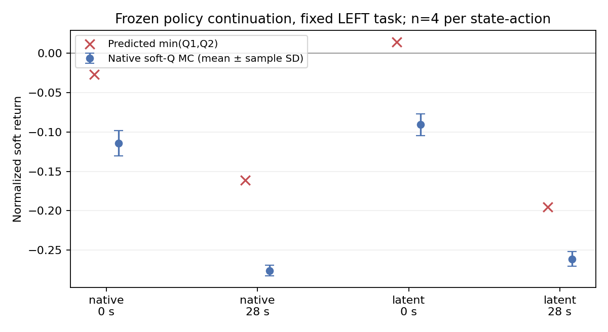

# T202：LEFT5m失败原因审计（2026-10-30）

LEFT原始5米仍未跑通。本轮冻结两个T200最终模型，完成48个真实MuJoCo分支，共812032诊断物理步，训练物理步和优化器更新均为0。48分支全部超时、0碰撞、0到达；不替换T159或已核验T194研究候选。Stage与Phase隔离。

目前有证据支持的解释是：**全程绕障成功数据存在缺口、初始物理油门探索发生塌缩、Critic长程估值偏乐观，以及固定保持项压制Q优化方向，共同把训练推向安全超时行为。** 已确认这些具体问题和测量结果，尚未通过逐因素干预证明它们各自的充分必要性，不能声称找到唯一根因、场景不可达或SAC普遍无效。

## 1. 直接失败点与训练后行为

T196完整状态复现确认：T194原始LEFT在30.064秒时由chassis_collision与real_circle_obs_9接触，剩余1.476674m；恢复后200物理步状态/观测误差0。该障碍中心约(0.9,-3.1)、半径.25m。T179曾完全移除它后到达，保留25%及以上半径仍碰撞；这不能证明原场景不可达。

T200最终两个模型的确定性LEFT均超时。本次在其自身原始reset及28秒状态，只改变一个.2秒动作后沿相同冻结随机策略续行，全部48次仍超时。任务没有产生跨越障碍的成功行为变化。此前RIGHT5m和旧六项保留的验收结果不变，本轮未重复它们来扩充样本数。

## 2. 确认：潜变量噪声大，不等于实际油门探索充分

当前warm start用z_mean=atanh(clip(native_mean,±.999999))，再采样z=z_mean+.5*epsilon、action=tanh(z)。T194共同LEFT轨迹151状态中92个（60.93%）油门正向clip，潜变量均值约7.24773。

在这些状态，油门低于.9的解析概率仅3.65e-31，低于.5约3.15e-41；中央95%实际油门区间为[.99999281,.99999986]。接近饱和的双曲正切把噪声压缩到很小的物理动作范围。T200首批六条原始LEFT真实探索877个决策中551个处于该区间，实际没有一次油门低于.9，观测范围[.99998522,.99999994]。

T200后置latent分支恢复了局部均值梯度，但零初始化保持了初始动作分布，因此也保留了这个探索问题。T196附加参数噪声仅作用于转向。最终模型可以通过其他状态/参数更新离开该区域，故这不是“永久无法减速”或单独足以解释所有失败的证明。详见exploration_support.json。

## 3. 确认：成功数据没有覆盖原失败前沿

T200每个最终经验池含97条原始LEFT回合，0GOAL、68碰撞、29超时。另有33条近目标LEFT回合，其中30条GOAL。两个经验池共享历史数据，不能把这些计数相加当成独立重复实验。

原始起点(-.75,.75)，父策略28秒失败前沿约(.82374,-2.20743)；近目标起点约(2.22155,-2.82075)，距该前沿1.526m。所有已有LEFT成功轨迹的点，距离该前沿最近仍1.502m。成功后缀与原始绕障区域之间没有已观察到的成功桥接。这是当前数据的事实，不是两个状态集合在动力学上不连通的证明。详见coverage.json。

## 4. 确认：终止拟合好、TD误差小，没有保证长程Q校准

T200终止Q1 MAE为.00930/.00758，非终止一步TD MAE为.01675/.01437。原有训练只要求已存终止MAE<.15便允许Actor更新，该门槛不检验长程值或动作排序。此次用同一最终冻结策略做真实随机续行，避免“旧行为回报与新策略Q不同”这个混杂。

| 模型/原回合时刻 | minQ预测 | 同一策略soft-Q MC均值 | 样本SD | 预测减MC均值 |
|---|---:|---:|---:|---:|
| native / 0s | -0.026501 | -0.113996 | 0.016032 | +0.087495 |
| native / 28s | -0.161299 | -0.275937 | 0.006739 | +0.114639 |
| latent / 0s | +0.014515 | -0.090664 | 0.013683 | +0.105178 |
| latent / 28s | -0.194934 | -0.261195 | 0.009088 | +0.066261 |

每组4个预声明噪声种子，MC统计为均值±样本标准差，不是置信区间。soft-Q按[SAC定义](https://spinningup.openai.com/en/latest/algorithms/sac.html)排除当前固定动作的熵，从下一决策起累计真实潜变量对数概率；环境回报、折扣、终止、原时限与剩余时间均逐数组独立复算。所有动作及log-density重建误差均0。

四个基准组minQ比采样均值乐观.0663–.1146。8个动作相对baseline的比较中，采样均值方向仅3个与预测一致，但多数MC差小于采样波动；不能把3/8当成已证明的总体错误率。latent的28秒Q正向动作预测增益+.006254，四条真实soft回报差都为负，平均仅-.00004545；它没有产生导航结果变化。所有分支均超时，环境完整回报的同起点/同时限差严格相消，动作差主要体现熵项。因此本轮证明了这些点上的估值失准和动作效应夸大，未验证任何能成功绕障的动作排序。

## 5. 确认：保持项梯度尺度和学习方向存在冲突

采用最终模型、真实最终replay的四个终止均衡批次，并将七组保持目标按各组等权取全体期望，离线分别计算-Q、alpha*logpi、10*BC的梯度，不执行更新。显式过去动作的10个零列按真实训练规则屏蔽。

native保持梯度/Q梯度范数比12.73–14.72，两者余弦-.571至-.260；Q+熵+保持合成梯度与Q梯度余弦-.516至-.241，即这四个批次的普通梯度方向都不沿Q下降方向。latent范数比4.83–7.51，保持与Q接近正交；熵与Q余弦-.977至-.959。两个模型旧状态动作RMSE仅约.006/.007，不能据“小保持损失”断言保持约束影响小。

这是最终检查点的梯度测量，使用保持项期望，非历史小批次或Adam动量的精确贡献重放；因此不能断言全部实际更新被保持项抵消。Critic本身未校准，也不能直接把放大Q梯度当解法。详见offline.json。

## 6. 为什么容易学成安全超时

归一化回报下，从相同5m初态，30.064秒碰撞的完整环境回报约-.47955，46.668秒安全超时约-.11215。避碰转为超时可以得到更高回报。终止一致势函数在完整轨迹上相消，同初态/同时限超时的不同最终距离没有回报区别。这是当前有限任务目标的性质，不是计数或reward符号错误。

在尚无原始LEFT成功数据的条件下，该目标支持安全等待的局部行为。42.794秒GOAL若能实现，环境回报约+.60948，但这个数字只是假设成功时间的公式例子，不能冒充LEFT可达性证据。T197已实际检验增加超时距离惩罚，仍无LEFT成功；因此不是简单删掉势函数修正或增大距离惩罚便已解决。熵对该平衡也有影响，但此前“只减alpha”草案不足以覆盖本次新发现。

## 7. 核对过的实现与尚未排除的解释

核对了实际绑定的运行时方法：stage9 patched_step委托原Stage1A.step，Ackermann修正只写actuator控制后执行真实mj_step；原生速度平方映射由StrictMuJoCoEnv._policy_to_commands拥有。成功半径仍.20m，500Hz物理、5Hz决策、frame_skip=1。基类另一个.92m成功判定不在当前实际step路径，不能误判为本轮验收漏洞。

本轮逐轨迹核对实际终止、原始目标不变、几何哈希、绝对剩余时钟、部分动作块终止、浮点事件mask、纯环境MC闭式值和soft-Q熵起算位置。396个此前三次Release原始文件哈希未变；./run_stage.sh另核验3240个历史归档文件与运行依赖通过，0物理步/更新。没有新增规划器、路点、执行期教师或模拟器运动覆盖。

仍未排除的因素包括：6ms历史和不输入实际转向状态导致的部分可观测性、完整车辆轮廓与点雷达间的差别、执行器动态与前进域控制限制。T198构造状态别名存在，但短时位移差不足1mm，不能直接把它列为主因。SAC Actor沿用Critic的终止均衡批次，使终止状态概率约25.5%，而均匀经验池约.68%；这也是需要独立比较的设计选择，尚未验证其因果效果。

## 下一步顺序

1. 先补足Critic多步值/动作效应验收，不能继续以终止拟合门槛代替。当前模型不因小TD误差获准自动追加Actor更新。
2. 单独修正实际动作探索覆盖，并对绕障前沿附近的减速/转向联合变化记录覆盖；不能只看潜变量sigma或恢复梯度。
3. 从已验证成功源做小幅reset邻域课程，逐步建立真实成功桥接；与原父策略同起点配对，固定真实最终目标，旧六项+RIGHT作为硬验收。
4. 在Q方向获得实测支持后，再单因素比较保持约束尺度/梯度冲突处理，保留旧七项硬门槛。熵尺度仅作独立次级因素，避免一起修改后无法归因。

下一步仅草案，未启动训练，详见next_protocol.md。本次没有新模型能力、算法优越性、创新或泛化结论。

## 文献对应与边界

- [Fu等，ICML2019](https://proceedings.mlr.press/v97/fu19a.html)：通过oracle式诊断区分Q学习瓶颈；支持本次真实分支审计的方法选择，不代替本项目因果证据。
- [SAC官方实现说明](https://spinningup.openai.com/en/latest/algorithms/sac.html)：区分soft-Q与当前动作熵，亦单独使用均匀初始动作探索；当前warm start没有对应的有效物理动作覆盖保障，不能将差别直接称SAC公式bug。
- [TD3+BC原作者实现](https://github.com/sfujim/TD3_BC/blob/main/TD3_BC.py)：依据Q尺度调节Q/BC平衡；本项目是固定七教师保持的在线SAC工程选择，既非该算法复现，也不能照搬归一化便宣称修复。
- [PCGrad，NeurIPS2020](https://proceedings.neurips.cc/paper_files/paper/2020/hash/3fe78a8acf5fda99de95303940a2420c-Abstract.html)：梯度冲突及投影处理已有方法。尚未实现或验证，不能当作本项目原创或已解决抗遗忘。

原始数据/协议在stage/runs/t202_cause_audit与stage/experiments/t202_cause_audit。全部结果为单张已消费地图的机制开发证据，四噪声种子不是独立地图或独立训练重复。

## 备份与容量

本轮68个原始文件共3521329字节，已在[增量Release](https://github.com/frank8763/winkun/releases/tag/stage-cause-audit-2026-10-30)核验备份。本地69个解压成员逐项哈希匹配，远端三个附件的服务端SHA256/大小匹配；未做完整远端二进制读回。归档3175482字节、SHA256 ecadc34a890650f2928749cef3633966df2adb8e5404806f722dc9648f6dd61d，核验后已删除临时包。全部新runs约938.03MiB，低于1GiB，空闲盘仍超过40GiB；所有实验进程已退出。

首次urllib备份API GET连续超时，未建立Release；随后使用已授权GitHub CLI完成上传并再次核验发布后的附件URL/哈希。未重启实验或重复打包，原始源文件和模型哈希不变。
