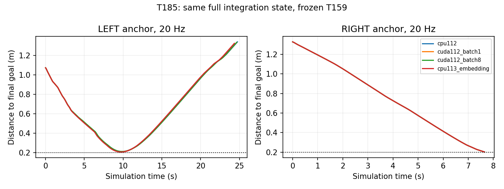

# T180–T185：成功课程训练与起点连接诊断（2026-10-30）

本轮实际完成了T183深度强化学习训练：两个Actor候选各96完整回合，共新增**1416504个物理步、14267个决策、496次Actor优化器更新**。同时完成固定偏置、横向起点、课程预检、起点连接与推理契约诊断。**两项原始5米仍0/2，旧六项3/4米保持6/6；没有替换T159。** 所有作业已结束，不自动继续加预算。

最重要的解释修正：T183保持权重10组在当前5Hz基线上从课程11/24变为12/24，但新增的那个案例在历史T172、20Hz下T159本来就成功。它恢复了一个当前入口下未复现的旧案例，不能写成获得了历史模型之外的新导航能力，更不能算完整5米突破。历史T172与当前入口的时限、计算路径及初态记录完整性不同，成功集合的对照只用于追踪来源，不作控制频率或算法的独立因果估计。

## 本轮实际结果

| 实验 | 设置与预算 | 结果 |
|---|---|---|
| T180 | T159最后线性层转向偏置[-.6,-.3,0,.3,.6]；5Hz，5候选×8任务 | 原始5米全部失败；仅零偏置保住旧6/6。544089物理步，零训练 |
| T181 | 原始起点沿目标方向垂线偏移[0,±.4,±.8,±1.2]m；14例 | 12有效例全部碰撞；2例初始碰撞判INVALID，没有重采样。136583步，零训练 |
| T182c课程预检 | 重建24个已消费T172起点；5Hz、统一46.668s；仅整合已完成9例与剩余15例 | 四距离档成功6/6、1/6、3/6、1/6，总11/24。近目标入口门槛通过。唯一计数187469步 |
| T183实际MC/PPO训练 | 仅保持权重10/1不同；每组96回合；固定近远课程顺序与原始5米注入 | 两组各42次训练到达；原始起点训练各0/20。最终原始5米均0/2 |
| T184 | 两个历史成功近目标起点→原始起点的reset位姿/朝向插值；每侧9点，20Hz | 左7有效、0成功；右7有效、仅近端1成功；共4例初始碰撞。125862步，零训练 |
| T185 | 两个同完整状态近目标起点×4种推理实现×2频率；16例 | 左8/8失败、右8/8成功；更换推理后端未翻转成功判定。128996步，零训练 |

T180改变的是网络参数，未在运行时叠加教师或动作控制器。T181/T184只在回合前改变训练reset，运行中仍由网络独立输出动作；这些插值不是车要走的轨迹，也没有作为路点输入策略。全部原障碍尺寸、位置保持不变。修改起点的到达不是原始5米能力。

## T183训练协议和冻结验收

Actor直接输出原生连续控制，113维输入含剩余时间；架构、物理折扣和条件AR高斯似然沿用T177/T178。使用完整实测MC回报、同reset独立配对回合基线和PPO截断目标，没有学习Critic，也没有借用T174/T175未过门槛的价值梯度。

先通过近目标6/6预检，再冻结12批×8回合的课程顺序。两组共用T159嵌入初始Actor、新随机种子、优化器配置、原生动作域[-1,1]、1秒AR相关时间、初始标准差[.25,.3]。固定课程每组32次最近档、24次第二档、12次第三档、8次最远档、20次原始5米起点。唯一组间差异为旧六项动作保持MSE的权重10或1。实际终止导致物理步数和KL提前结束的更新数不同；没有根据评估挑选中间模型。

| 最终候选 | 新训练物理步 | 决策数 | 更新数 | 训练到达/碰撞/超时 | 冻结旧六项 | 冻结原始5米 | 冻结课程 |
|---|---:|---:|---:|---:|---:|---:|---:|
| 初始嵌入Actor | 0 | 0 | 0 | — | 6/6 | 0/2 | 11/24 |
| keep10 | 701482 | 7063 | 244 | 42/53/1 | 6/6 | 0/2 | 12/24 |
| keep1 | 715022 | 7204 | 252 | 42/52/2 | 6/6 | 0/2 | 11/24 |

三个冻结模型×32案例，共96次评估、875228物理步。CPU/GPU行为log概率最大误差3.85e-5，低于2e-4门槛；两最终Actor参数确实变化，旧滚动断点在最终评估后删除并记录哈希。最终点SHA256：keep10 `9ae6a3160addfd91ea0f81de60abdde2064c0b51ae24028e55eb7c3e2af4fe24`；keep1 `549413b9a5c3b4aa01263f3beedfd3d258bf275ee3f87ff51c340656f8e07414`。

keep10相对当前初始模型唯一新增通过为`course_phase1_side0_draw0`，从距目标1.073m的起点运行9.078s到达；初始模型在24.314s碰撞。没有损失当前11个成功起点。但其成功集合与历史T172的12项恰好相同。**当前只能报告受控入口下的单例恢复，不能宣称超过历史T159、跨布局泛化或统计优势。**

降低保持权重没有在这个单种子、小预算协议中带来收益。梯度冲突存在，不等于保持项就是5米失败主因。最近档64/64训练回合都成功，最远档16/16都碰撞，40次原始起点训练注入零到达：当前课程有成功样本，却没有把成功范围扩展到原起点。这比“所有回合无成功”更具体地定位了下一阶段的数据覆盖问题，但仍未证明课程连接是唯一因果瓶颈。

## 为什么不继续按距离加课程

T182最近到最远各档初始成功数为6、1、3、1，难度不随欧氏距离单调变化。部分历史径向起点位于同一障碍的另一侧，成功到达不保证能接续原来的进场方向。T184进一步直接检查reset插值：左alpha=.125/.25、右alpha=.625/.75初态接触障碍，判INVALID。其余过渡点也没有形成连续成功区间。

它不证明原任务不可达，也不能证明所有局部课程方法无效；它说明**不能把径向距离或一条直线插值当成已经验证可学习的课程**。下一步要保存完整状态、核验实际成功与扰动稳定性，再按能力扩展起点区域。此前草案没有转成自动无限训练。

## 历史成功未复现的边界与T185

T184左近端alpha0来自T172的位姿摘要，当前运行最近距目标0.2111m，错过0.20m阈值后继续运动，最终碰撞；右近端仍通过。T172未保存这些回合的完整MuJoCo积分状态和全部Python缓存，仅凭起点位姿及四舍五入的qpos/目标哈希，无法建立完整初态逐比特相同。因此不能直接归罪于GPU、模拟器bug或算法失效。

为排查推理实现，T185在每个锚点内核验`mjSTATE_INTEGRATION + 112维观测 + 目标`字节哈希一致，再比较CPU112、CUDA112单批、CUDA112批8、CPU113等价嵌入，在20Hz/5Hz各运行一遍。所有参数冻结；同一观测上的原生命令最大差异1.20e-6。左侧8种组合最近距离0.2045–0.2111m，全部最终碰撞；右侧8种均原生GOAL。只支持这些受控组合下判定一致，不支持把数值后端认定为主要原因，也没有排除历史可变批大小或未记录初态的影响。

不能扩大成功半径来消除这些失败。它们暴露了目标捕获裕度较小的问题；后续成功源应保存完整状态并检查小扰动下是否仍然到达。图中左侧接近目标不算成功，继续碰撞同样保留。

## 两次预检中断，保留原始证据

T182第一次因检查权重的变量与动作变量重名，在回合后核验处报错；修复命名后独立T182b继续，完成9例后被历史姿态四元数的符号表示差异拦截。零物理步审计对24条记录逐条找到了与源的8位小数qpos/目标哈希一致的四元数表示；T182c复用已完成9例，只运行剩余15例。没有改写前两次代码、协议或失败日志。

24例预检的187469步只统计一次；中断尝试里未记录的在途物理步无法精确恢复，合计上界373344，**不能写成零、精确总量或有效训练量**。本轮有记录的非训练诊断物理步1122999，另计T183冻结评估875228；训练量1416504单独统计。所有原始文件与失败状态纳入归档。

## 文献、下一步和创新边界

参数诊断参考[Parameter Space Noise for Exploration](https://arxiv.org/abs/1706.01905)的整回合行为一致性思想，固定偏置网格不是完整算法复现。课程方向参考[Reverse Curriculum Generation](https://proceedings.mlr.press/v78/florensa17a.html)，当前径向reset采样和插值不等于其原方法。策略更新采用[PPO](https://arxiv.org/abs/1707.06347)截断目标，使用完整MC配对基线而非声称复现所有原论文设置。

下一步优先做**完整状态成功锚点的扰动稳定性预检**，再进入基于实际成功率的局部起点区域扩展；使用原尺寸障碍、固定最终目标，训练阶段才安排reset，运行中仍是单网络端到端控制。协议与停止门槛见[next_protocol.md](next_protocol.md)，尚未启动。不能再用历史位姿摘要或单次到达自动认定课程入口。

本轮没有证明新的原创算法优势，也没有未知地图或真机证据。T159继续作为正式保留模型；T183 keep10只作为带完整来源的研究候选保存，不能当成旧TD3完整断点恢复。

协议输入、模型哈希、源成功集合比较、步数和失败记录核验见[verification_and_metrics.json](verification_and_metrics.json)。模型/长轨迹使用核验后的Release附件保存；代码、协议与结果摘要进Git，Stage与Phase保持隔离。

## 已核验远端归档与磁盘占用

本轮248个原始文件（29357197字节，约28.00MiB）及两个最终模型已在[增量Release](https://github.com/frank8763/winkun/releases/tag/stage-onpolicy-course-2026-10-30)发布。压缩包25641840字节，SHA256 `be2a8e2e26a71d7efd55f4c86d2cdd384c29c59d1c317e734e31923d04b0e7ae`；本地249个解压成员逐一核验，远端3附件服务端SHA256/字节数匹配，未做完整远端二进制重新下载。临时包已删除，全部新runs逻辑大小684507958字节（约652.80MiB），仍低于1GiB。历史3240文件和前轮T176–T179的157个原始文件哈希再次核验通过。所有本轮父/子进程均退出。
