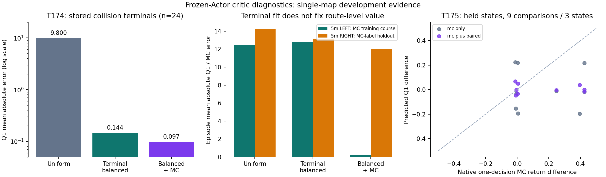

# Stage T173–T175：Critic错误、修正及范围

结论：确认了**碰撞终止样本学习不足**这个具体故障，并用单因素采样对照修复了已存终止样本上的误差；但长轨迹价值和动作排序仍不能可靠迁移到不同状态。没有训练新Actor，没有5m能力提升，不晋升模型，继续保留T159。

代码和协议在stage/experiments/t173_q_audit、t174_critic_alignment、t175_paired_advantage；原始输出在同名stage/runs目录。Phase聊天、模型、研究结果和规划器均未使用。历史快照、T145/T146只读。所有模型与结果按哈希核验。

## T173：原生价值与动作干预审计

冻结T171 Actor和Critic，CPU单样本推理、20Hz动作、500Hz原生物理。八项已知任务连续执行到真实GOAL/COLLISION或93.336s诊断时限。每个物理块的实际回报与原T169稀疏目标、60s折扣一致，另用终止势函数望远镜求和的闭式公式逐轨迹核验。诊断延时不会放宽原始主验收：3m28s、4m37.334s、5m46.668s。T171困难3m右侧在诊断延时内到达，仍不算原主验收通过。

| 原始5m任务 | 初始Q1 | 初始Q2 | 原生完整实际回报 | 全轨迹Q1/MC平均绝对误差 |
|---|---:|---:|---:|---:|
| LEFT | 6.725 | 6.477 | -4.468 | 12.846 |
| RIGHT | 6.404 | 6.349 | -3.561 | 14.501 |

两项均碰撞。TD3目标平滑策略与本审计的确定性部署策略存在差别，因此不将所有Q/MC差值都解释为同一个理论意义的估计偏差。更直接的证据是：**已经存入replay的24条碰撞吸收转移，其目标完全不含bootstrap**，真实目标均值-9.583，而Q1均值+2.485，MAE12.069；min(Q1,Q2)的MAE仍11.961。这里不能用未来策略差异解释终止目标错误。

最终replay20000条，碰撞终止24条（0.12%）、到达终止69条（0.345%）。在这个固定replay快照上，原均匀192条在线采样的预期碰撞终止数仅.2304，约79.4%的批次没有碰撞终止；另64条旧成功演示没有碰撞。该比例只描述最终快照，不冒充全部历史训练批次的统计。

动作排序审计使用三个已知任务（两项5m和旧3m困难右转），各在0/10/20s的同一原生状态，比较baseline、Q1动作梯度±.25、T159动作。只干预一个25物理步决策，随后全部沿用冻结T171，故完整回报差是该固定继续策略下的动作差。所有分支从原始reset重放相同前缀，MuJoCo完整integration状态、观测和最终目标哈希匹配；三次baseline重复的回报误差均为0。没有部署规划器、虚拟目标或教师切换。

Q1梯度正向9项只有5项实际回报差同号；其中5m为2/6。并非每项错误都改变了碰撞结局，折扣负惩罚还会奖励“稍晚碰撞”；因此标量回报增加不能算到达能力提高。47次执行共795686个物理步，零训练更新。多个状态来自同一轨迹，不能当成独立训练重复。

原生接触证据：左侧chassis_collision碰到real_circle_obs_9；右侧车辆几何体碰到real_rect_obs_3。右侧终止雷达最小射线仍约.229m，延续T163所识别的射线距离与车辆完整轮廓净空差别；不是传感器漏检或唯一原因的证明。当前T169后回报已无T59额外净空项，不能把旧T59圆形覆盖限制直接当成本次Critic错误的原因。

## T174：三组固定数据、固定Actor的修复对照

共同T171 Critic/优化器初始化，每组固定2000次GPU更新，Actor零更新、零新增物理步。学习率、TD3目标平滑、Polyak更新、旧演示、批量、随机流和预算相同。终止均衡只将192条replay采样改成96均匀+48碰撞终止+48到达终止，另64旧演示不变；第三组仅额外加入MC监督。均匀→均衡只改变采样；均衡→均衡+MC只改变MC项。

MC监督用四条3m成功课程和5m LEFT碰撞课程；两条4m与5m RIGHT的完整回报标签不加入MC梯度。后者仅称“回报标签留出”：对应已知任务和带噪状态可能存在于父replay，绝不是未见任务或跨地图测试。

| 组 | 已存碰撞终止Q1 MAE | 已存到达终止Q1 MAE | 3条回报标签留出课程平均Q1 MAE | 5m固定Q正向候选排序 |
|---|---:|---:|---:|---:|
| 均匀 | 9.800 | 1.899 | 5.376 | 2/6 |
| 终止均衡 | .144 | .106 | 5.572 | 2/6 |
| 终止均衡+MC | .097 | .090 | 5.137 | 2/6 |

采样改变在相同预算下修正了已存终止样本拟合；但没有解决整段路线与动作排序。第三组5m LEFT轨迹MAE降至.244，RIGHT仍12.016，说明只监督一条失败路线不足以迁移。所有组均未通过预声明Critic门槛，不能据终止拟合好就更新Actor。

## T175：价值拟合与动作优势是不同的问题

共同从T174均衡+MC Critic开始，Actor仍完全相同。两组均用八条完整T171轨迹MC和终止均衡TD，共同增加每条轨迹最初两块的采样；组间唯一差别是配对动作回报差损失，固定2000次更新。T174→T175之间还有共享数据变化，因此仅用T175两个组之间比较配对损失效果。

配对监督训练为三个任务的0/20s六个状态、每状态三个动作相对baseline的真实回报差（18项）；10s的三个完整状态、九项动作差留出。baseline的普通MC值可能在共同价值训练里出现，但这些留出动作结果不参加配对梯度，不能称整个状态完全未见。

另重建T172的24个相同reset初始状态，哈希24/24匹配，**不步进**模拟器。16条真实终止初始回报用于评估，8条超时删失标签遮罩，不伪造安全/失败。它们是同地图、已消费的开发测试，初始回报标签不进入梯度。历史T172用GPU Actor、本轮T173用CPU Actor，浮点数值策略差异也是范围限制。

| 组 | 训练动作排序* | 留出状态动作排序 | 训练动作回报差MAE | 留出动作回报差MAE | 8条训练课程Q1 MAE | 16个不同初始状态Q1 MAE |
|---|---:|---:|---:|---:|---:|---:|
| 仅MC+均衡TD | 5/17 | 4/9 | .2680 | .2584 | .1902 | 6.9419 |
| 加配对动作监督 | 16/17 | 5/9 | .0024 | .1864 | .1896 | 6.8280 |

*18个训练对里一项实际回报差约2.4e-14，低于预声明1e-5阈值，不计入有效排序。九个留出比较仅来自三个状态/三个课程，不能作显著性或普遍算法结论。

局部优势可被直接监督拟合，但没有可靠迁移；标量价值拟合到.19，也没有保证不同起点上的价值或动作梯度准确。两个组均未通过预声明门槛。没有新Actor、导航收益、独立多种子结论或真机结论。

## 确认了什么，下一步解决什么

1. 已确认：最终经验池的稀少碰撞终止样本未学好；终止均衡在固定预算对照中修正此故障。
2. 已确认于这些开发案例：小训练误差、两个Critic取min、MC价值监督、局部配对动作拟合，都不足以保证不同状态上的正确动作评价。
3. 未确认：唯一根因、网络容量不足、观测本质不可辨识、某种新风险机制一定有效。当前数据不足、分布转移和动作优势识别是需要区分的因素。

下一步先扩大**固定当前策略下、接近真实碰撞前沿的状态与动作结果覆盖**，保留独立起点家族和整段时间窗口验证；再比较普通TD、完整回报和配对动作监督。部署依旧单Actor从局部传感和真实最终目标输出动作。旧六任务闭环验收为硬门槛，动作MSE不能替代。具体下一阶段边界见[next_protocol.md](next_protocol.md)，尚未启动新Actor训练。

## 文献与创新边界

- [TD3，Fujimoto等，ICML2018](https://proceedings.mlr.press/v80/fujimoto18a.html)：函数近似误差、过估计和延迟策略更新已有系统研究；本轮是在本系统中测量，不是发现全新普遍现象。
- [BEAR，Kumar等，NeurIPS2019](https://proceedings.neurips.cc/paper/2019/hash/c2073ffa77b5357a498057413bb09d3a-Abstract.html)：数据支持以外动作的bootstrap误差已有研究；本轮未实现BEAR，不移用其保证。
- [Fu等，ICML2019](https://proceedings.mlr.press/v97/fu19a.html)：Q学习瓶颈诊断已有先例；本轮控制组和误差分解属于必要研究基线。
- [TRPO，Schulman等，ICML2015](https://proceedings.mlr.press/v37/schulman15)：vine分支采样已有先例，依赖仿真重置能力；本轮重放前缀的配对实验不是独立创新或TRPO复现。
- [Q-Prop，ICLR2017](https://arxiv.org/abs/1611.02247)：将实际采样与Critic梯度结合已有研究；本轮没有实现其控制变量估计器。

顶刊候选问题仍为“物理时间下的到达/碰撞预测及动作优势可靠性如何改善部分可观测长程导航”。本轮识别了可证伪的失败环节，没有证明新方法有效。终止均衡、MC拟合、配对回报监督的简单组合不能直接充当创新结论。
