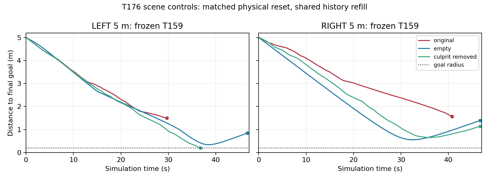

# Stage T176–T178：场景、动作范围和持续探索（2026-10-30）

当前判断：不能把5米失败归结为“SAC/TD3算法不行”或“地图太难”之一。现有证据同时指向价值学习、状态覆盖、控制接口及障碍交互；本轮绕开Critic后的直接策略学习仍没有产生到达经验。**原始5米仍0/2，保留T159；无新模型晋升，无顶刊创新有效性或真机结论。**

全部实验已完成，没有后台训练。新代码和输出均在winkun，Stage与Phase隔离，没有外部规划器、人工路点或运行时教师。GitHub负责版本和附件保存，计算仍在本机进行。

## 已执行的受控实验

### T176：冻结同一个T159，改变障碍组件

27次原生运行、349020物理步、零训练。每个场景配对的初始物理状态和最终目标哈希相同。仅改变运行实例中的官方障碍几何/碰撞掩码，没有修改归档模拟器。全移除组初始48束雷达全部为6米。

| 场景 | 左侧5米 | 右侧5米 |
|---|---|---|
| 原始障碍 | 碰撞，29.692s | 碰撞，40.752s |
| 全移除 | 超时，采样最近0.339m | 超时，采样最近0.554m |
| 只留矩形 | 到达，37.652s | 碰撞 |
| 只留圆形 | 碰撞 | 超时 |
| 只移除原接触对象（左circle9、右rect3） | 到达，36.766s | 超时 |

全移除后，行程左5.870m、右6.660m，最终距目标0.843m/1.391m；没有达到原0.20m成功半径。冻结策略在改变后的雷达分布上失效，**不能推论空场不可学、原任务不可达，或物理系统不能完成5米**。移除circle9后左侧成功，证明该场景干预能改变当前策略结果，但同时改变了观测与接触，不能将二者分别归因。

契约差异：旧任务工厂改变3米目标为4/5米时，没有重填历史观测缓存。T176所有场景统一重填历史，以保证组件对照一致；因此其“原始”曲线不是旧测试逐比特复现。T177/T178恢复旧工厂主验收契约。不同契约结果分开保留，不用新曲线覆盖旧证据。

九个10秒固定动作探测还确认转向响应较慢：最大转向指令下，最后2秒平均角速度约0.018–0.048rad/s，速度/角速度比约1.74–2.19m。这是有限时长探测的末段均值，**不是已经证明收敛的稳态或严格最小转弯半径**。历史两次油门映射限制原生油门在[0,1]，无法请求原生-1的零驱动；零驱动也不等于瞬间停车或支持倒车。

### T177/T178：独立于未通过审计的Critic，实际训练四个Actor

采用PPO截断目标，完整实测MC回报，独立同起点配对回合作基线；没有学习Critic，没有bootstrap，没有混入旧replay。旧六项成功状态只用于动作保持正则。

单网络为113→800→600→2 Tanh→可训练2×2原生动作输出层；第113维为剩余任务时间。初始化物理动作嵌入T159，最大误差8.05e-7，5Hz决策下旧六项通过。动作仍由一个网络直接输出。探索使用可计算精确条件似然的AR(1)高斯过程；冻结部署只取网络确定性均值。

四个训练起点是T159在真实5米原场景中、碰撞前约6/12秒的完整物理状态，距最终目标约1.87–2.51m。跨独立环境恢复后未来200物理步，状态与观测误差均0。只在回合开始恢复，运行中不改位姿或目标；这类子任务通过也不等于整段5米通过。

| 实验组 | 完整训练回合 | 新训练物理步 | Actor更新 | 训练到达/碰撞/超时 | 冻结旧3/4米 | 冻结原始5米 | 冻结四个前沿 |
|---|---:|---:|---:|---:|---:|---:|---:|
| T177 原生油门[0,1]，τ=1s | 48 | 222695 | 80 | 0/48/0 | 6/6 | 0/2 | 0/4 |
| T177 原生油门[-1,1]，τ=1s | 48 | 262605 | 92 | 0/48/0 | 6/6 | 0/2 | 0/4 |
| T178 原生油门[-1,1]，τ=1s | 48 | 254884 | 96 | 0/48/0 | 6/6 | 0/2 | 0/4 |
| T178 原生油门[-1,1]，τ=8s | 48 | 291797 | 104 | 0/43/5 | 6/6 | 0/2 | 0/4 |

合计1,031,981新增训练物理步、372次Actor更新，不含准备和冻结评估。每组预定6批×8完整回合，最高576k物理步；实际因终止更早而少于上限。只验收固定最终模型，不选最好的中间点。CPU/GPU行为对数似然最大误差T177为1.43e-5、T178为5.91e-5，均低于预定2e-4门槛；四个Actor参数确实发生变化，非只换文件名。

T177组间仅油门下界变化；T178组间仅探索相关时间变化。T177与T178随机种子不同，不能把跨实验组混为严格配对。与之前TD3相比，PPO、时限输入、探索、reset、有限任务回报等多项同时变化，不能称SAC/TD3/PPO算法排名。48回合的小预算也不足以否定任一算法的学习能力。

8秒组的5次超时不等于绕行学成：其中3次多数决策使用负原生油门，体现减速；一条距目标0.621m，另外几条仍较远。全部确定性冻结前沿仍碰撞。长相关探索出现不同结局，但没有形成可验收的新技能。

## 进一步的学习信号解释

本轮为明确的有限24秒任务：每秒-0.01，到达+10、碰撞-10、任务超时-5；物理折扣exp(-0.002/60)，势函数Φ=-0.3d，全部任务终止取Φ=0。完整MC中的势函数奖励严格望远镜消去，只留下初态常数。因此同起点、同24秒超时的两条轨迹即使最终距目标不同，回报仍相同。

数据确实出现这样的例子：RIGHT_before12s下0.621m和2.265m的两个超时回合，初始回报均约-2.808395。这符合已声明的有限任务目标，并非漏算奖励；但说明**全部回合都失败时，完整MC主要能区分碰撞时间与存活，缺少指向成功绕行的经验信号**。势函数在这里不能凭空替代成功覆盖。它是改进课程的依据，尚不是单因素证明“成功稀缺是唯一原因”。

同时，探索动作仍有较高裁剪比例；保持正则、学习率、饱和输出和当前reset是否已太晚，也没有在本轮分别排除。四组只说明这些具体设定没有解决任务。

## 如何看待历史SAC与论文

读取了Stage归档中C147 SAC训练源码。其任务/奖励修补与当前协议不同，也缺少本轮匹配的多随机种子结果；不能把历史失败当成“SAC不适合本项目”的证据。

- [SAC，ICML 2018](https://proceedings.mlr.press/v80/haarnoja18b.html)：随机Actor与熵正则仍配合学习Critic。由此推断，直接切换SAC不会自动修复本项目的错误价值或经验覆盖；这不是该论文对Stage的结论。
- [PPO，2017](https://arxiv.org/abs/1707.06347)：借鉴截断策略目标。本轮完整MC/配对基线不是原论文所有实现细节或GAE配置的复现。
- [Autoregressive Policies，IJCAI 2019](https://ijcai.org/proceedings/2019/382)：借鉴有可调时间相关性的高斯探索；T178直接检验1s/8s。它是已有方法，不能算本项目原创。
- [Time Limits，ICML 2018](https://proceedings.mlr.press/v80/pardo18a.html)：有限时限属于任务时，策略应知道剩余时间；本轮因此加入时间输入。不能与“截断无限任务仍bootstrap”混用。
- [Reverse Curriculum Generation，CoRL 2017](https://proceedings.mlr.press/v78/florensa17a.html)：支持从易起点扩大课程的方向；真实失败前状态reset不是原论文Brownian反向课程的精确复现。
- [Curriculum Learning for RL Domains，JMLR 2020](https://www.jmlr.org/papers/v21/20-212.html)：课程可组织不同任务/样本难度。结合T176，下一步选择障碍尺寸课程是本项目的工程推断，不是论文替本项目证明有效。

## 下一步选择与论文边界

优先做**能产生成功轨迹的障碍难度课程**，而不是继续增加失败前沿的同类训练量或再次换算法名字。先冻结核验左circle9的尺寸恢复曲线，保留起终点、全程目标和其他障碍。随后仅在确实可通过的简化条件起步，以原场景最终验收为唯一能力标准；右侧尚无同样成功起点，不能直接套用左侧结论。具体有界草案见[next_protocol.md](next_protocol.md)，尚未启动。

原场景的整条动态可达性仍未证明，不能仅凭起终点无碰撞推断。未来创新应围绕“物理时间一致的长时到达/碰撞信用分配与成功覆盖”提出可证伪机制，并完成多种子、跨布局、消融与传感误差验证。PPO、AR探索、课程组合本身不足以支持原创性或顶刊主张。

## 核验与归档

协议、源码输入哈希、四个最终模型哈希、步数和冻结分数见[verification_and_metrics.json](verification_and_metrics.json)。原始失败、状态恢复快照、批次数据和模型均保留；本轮旧滚动断点在最终评估后删除，逐组保存哈希收据。所有新runs总量约623.5MiB，低于1GiB上限；临时归档上传核验后删除。最终远端收据与精确占用以release_receipt.json为准。
