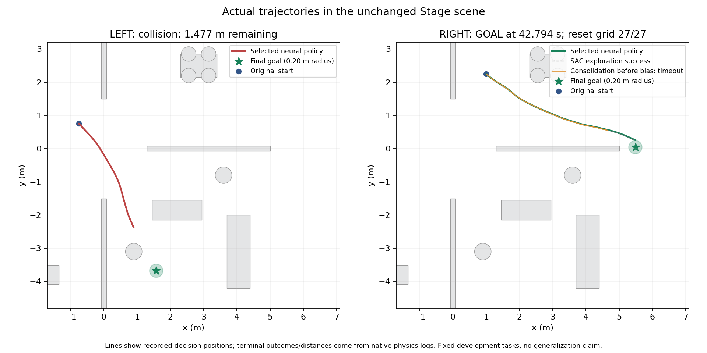

# T193–T195：右侧原始5米首次确定性通过（2026-10-30）

**保存的单个端到端神经策略在原始RIGHT5m到达：42.794s、无碰撞；旧六项3/4m仍6/6。原始LEFT5m仍碰撞，左右5m合计1/2。** 正式保留模型仍T159，本轮保留T194研究候选用于下一阶段；没有自动晋升，没有长距离/跨地图/真机/创新优越性结论。

## 可追溯的训练与验证链

1. T192独立SAC对照中的`no_her_b4_w7`真实探索RIGHT5m成功，46.086s，无碰撞。HER组没有原始5m训练成功，两组预算最终确定性均0/2；此结果不支持HER优越性。
2. T193按预声明顺序选每个方向最早成功，实际只有RIGHT一条。在全新原始环境重放真实原生命令，23043物理步、所有113维观测和每一步物理xy误差均0，原生GOAL时间完全一致。这只验证训练数据，不当成部署验收。
3. 从保持旧六项的T190研究Actor初始化，固定5000次均衡监督更新整合六项旧数据与新增RIGHT成功数据。最终单网络旧6/6，RIGHT5m超时最近0.9741m，LEFT碰撞剩余1.4771m。新任务训练MSE.06363明显高于六项旧任务.00047–.00095；单条高噪声成功轨迹尚未被精确吸收，不能称克隆已足够。
4. T194预先锁定原生油门神经头偏置+.05/+.1/+.2/+.3四值，全部32个任务结果保留。旧六项各组均6/6。RIGHT5m前两项超时最近.6107/.2711m，+.2和+.3原生GOAL分别42.794/40.364s；LEFT各组碰撞。按预声明条件“旧六项全保留、最多5m通过、最小改变量”保留+.2，不按最快选择。
5. T195从已保存候选重新加载，在全新环境复现原八项。每项步数、终止结果、最近距离及轨迹文件SHA256与T194对应候选完全相同。RIGHT初始x/y各±3cm、yaw±2°的27组合（零点复用上述RIGHT原任务）全部到达，无碰撞/超时。

| 冻结任务 | 结果 | 范围 |
|---|---:|---|
| 旧六项3/4m | 6/6 | 已消费的固定训练任务 |
| 原始RIGHT5m | GOAL，42.794s | 原始46.668s时限，0.20m半径不变 |
| RIGHT起点小扰动网格 | 27/27 | 同图开发诊断；非跨地图泛化 |
| 原始LEFT5m | 碰撞，剩余1.477m | 仍未通过 |

## 实际部署约束

最终策略仍为一个113输入、2原生命令输出的神经网络，当前雷达/相对最终目标/车体状态/原生历史/剩余时间直接产生动作。无外部地图、规划器、人工路点、运行时教师或动作序列重放。障碍几何、成功半径和任务时限未放宽。T193重放数据审计与T194/T195闭环验收明确分开。

T195非零扰动只在第一物理步前修改起始位置/朝向，重新读取当前传感器，并保留原工厂历史缓存和prev_action；零点使用原始工厂观测，未另加一次forward。这一历史契约有已知初始缓存局限；不能将它解释为真实传感器误差验证或clean-history部署鲁棒性。27个组合也不等于27个独立随机地图/训练种子。重复的原始成功是可复现性证据，不重复计独立成功样本。

本轮最终模型由真实RL成功数据、监督整合和有界神经参数校准共同得到。端到端的是部署控制链；不能将5000次BC、参数网格或复测冒充纯RL更新，也不能将这些已有工程方法单独包装成顶刊创新。当前结果只推进了RIGHT一个固定5m任务。目标和车体状态仍由仿真真值构造，尚未验证真实定位/感知误差。

## 计数、模型与下一阶段

T193新RL训练物理步0、RL更新0，监督更新5000；数据审计23043物理步、最终冻结111018步。T194冻结诊断414677物理步，T195核验665469步，均零优化器更新。实际来源SAC训练量另见上一阶段T192报告，不在此重复计为新增训练。

候选`stage/runs/t194_drive_sensitivity/selected_policy.pt` SHA256：`4848d7bcb38a140eda227975d7c338b5eb8ad655e5ce64bea3f84ac3c89e7656`。相对T193只有`native_head.bias[0]`加.2；其余参数逐项一致。原始失败、全部候选、真实成功来源及旧归档哈希保留。

下一阶段集中解决LEFT5m，保持这七项已通过的训练任务；双向原始5m通过之前不进入更长距离。方法草案和预算见next_protocol.md，尚未启动。

T193–T195的115个原始文件和模型已在[增量Release](https://github.com/frank8763/winkun/releases/tag/stage-success-consolidation-2026-10-30)备份：本地116成员逐项哈希校验，远端三个附件服务端SHA256与大小一致；未执行远端完整二进制读回。临时归档已在核验后删除。本阶段原始数据约9.74MiB，所有新runs累计约791.95MiB，低于1GiB，可用盘约200.6GiB。所有实验进程已退出。
